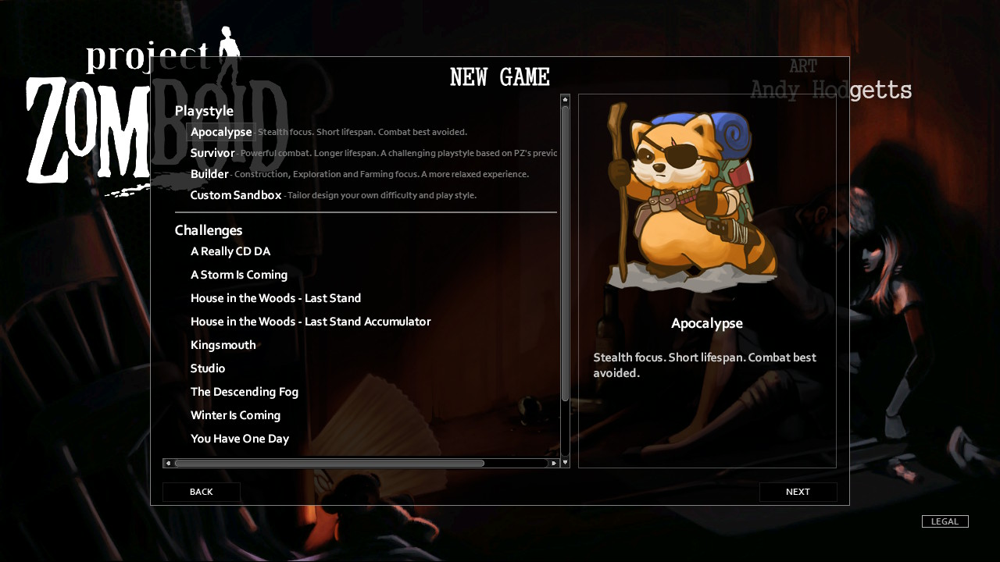
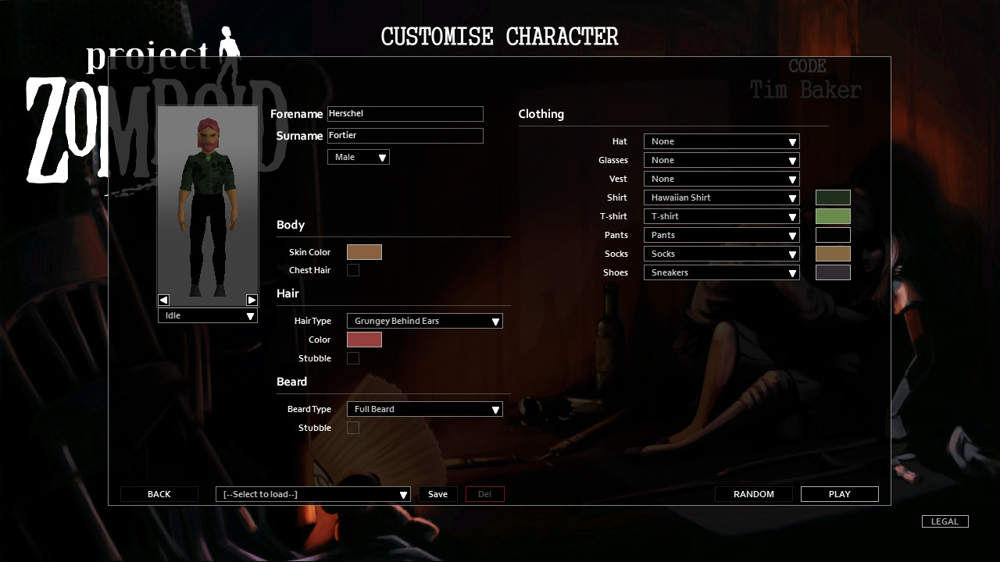
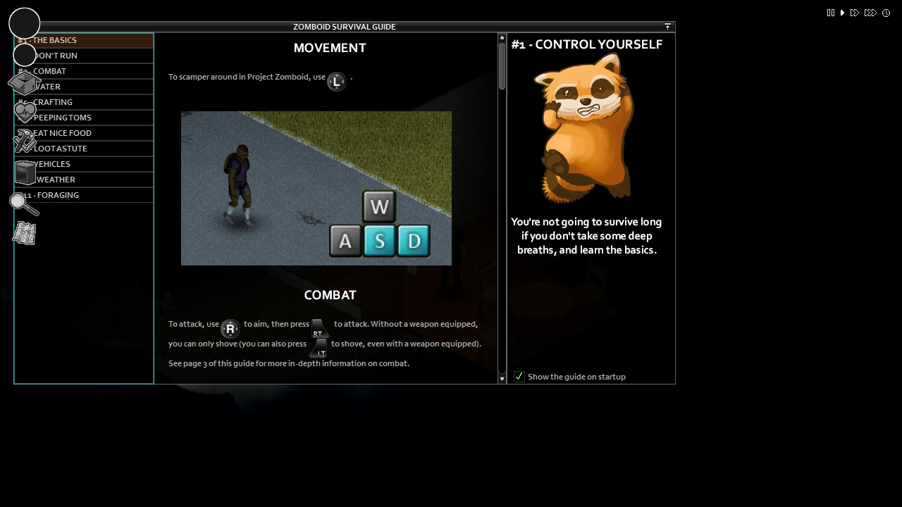
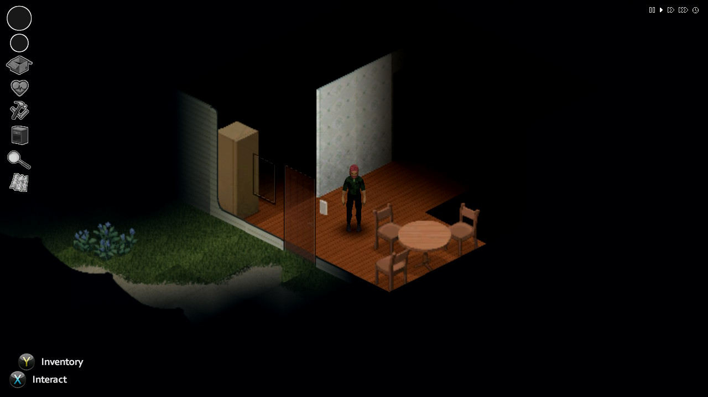

# Project Zomboid build 41 for Nintendo Switch

[Discord](https://discord.gg/dv28MgtaNn)

A native homebrew port of Project Zomboid 41.78. The game's Java code is compiled ahead of time with GraalVM
native-image, a small Linux layer on libnx runs it, box64 runs the game's x86-64 libraries, and BetterFPS (PotatoePC)
keeps the loaded map small enough for the console's memory.

No game files are in this repository. You need your own copy of Project Zomboid.






## Building

Linux x86-64 host with:

- devkitPro with `switch-dev`, `switch-mesa`, `switch-libdrm_nouveau`
- `aarch64-linux-gnu-gcc`, `cmake`, `python3`, `imagemagick`, `git`, `curl`, `unzip`
- GraalVM CE 25.0.2 for linux-x64 in `~/graalvm-25/x64` (or set `GRAALVM`), with the aarch64 libraries from the
  linux-aarch64 download copied in:
  `lib/static/linux-aarch64` and `lib/svm/clibraries/linux-aarch64`
- about 24 GB of RAM for native-image

Game files (DepotDownloader, Linux depot of build 41.78, and the BetterFPS workshop item):

```
DepotDownloader -app 108600 -depot 108603 -manifest 8887512142279836582 -username YOU -dir pz41/game
DepotDownloader -app 108600 -pubfile 3022543997 -username YOU -dir pz41/mods/betterfps
mkdir -p pz41/mods/betterfps/classes/zombie/iso
cp pz41/mods/betterfps/mods/BetterFPS/media/PotatoePC/zombie/iso/IsoChunkMap.class pz41/mods/betterfps/classes/zombie/iso/
```

The build also takes LWJGL 3.4.1 and sqlite-jdbc classes from the current (build 42) `projectzomboid.jar` from Steam;
set `B42JAR` if it is not in the default Steam folder.

Then:

```
pz-switch/setup-deps.sh
pz41/build.sh
```

This gives `pz41/pz41.nro`.

## Installing

SD card layout:

```
switch/pz41.nro
pz41/args.txt                 from pz41/args.txt
pz41/game/x86libs/            from pz-switch/xfer/x86libs (fetched by setup-deps.sh)
pz41/zomboid/options.ini      optional: low texture settings, recommended
```

plus the game data, built from the game folder:

```
python3 pz41/share/setup-sd.py pz41/game/projectzomboid out
```

and copy `out/pz41` onto the card. Start the NRO in full-RAM mode (hold R while starting a game). The first load
into the world takes 3-4 minutes. Controller and touch screen both work.

Recommended `options.ini` settings: `texture2x=false`, `maxVehicleTextureSize=1`, `simpleClothingTextures=2`,
`simpleWeaponTextures=true`.

## Credits

[zomdroid](https://github.com/liamelui/zomdroid) for the box64 JNI bridge design and its box64 fork,
[BetterFPS](https://steamcommunity.com/sharedfiles/filedetails/?id=3022543997), LWJGL, musl, GraalVM, devkitPro.
Project Zomboid is by The Indie Stone.
